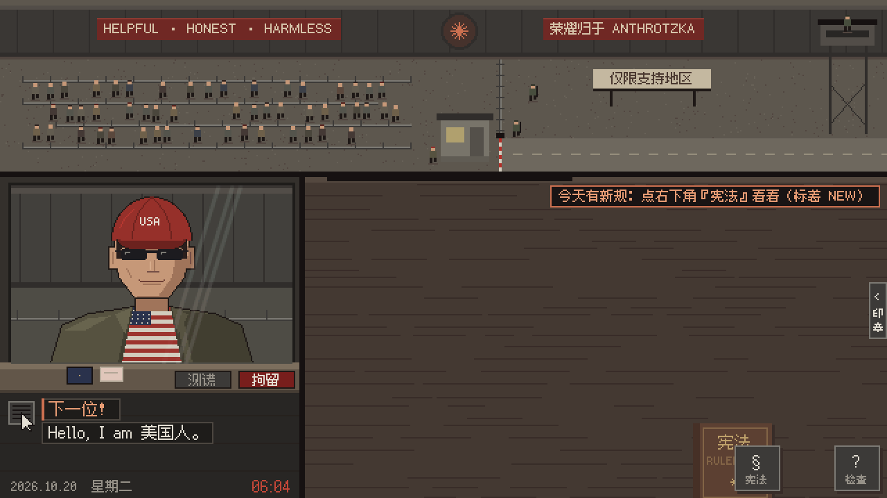

<p align="center">
  
</p>

<h1 align="center">IP, PLEASE: Modder's Cut· 请出示你的IP:加长版</h1>

<p align="center">
  <b>原作者</b>：<a href="https://github.com/ctnyanya">ctnyanya</a> · <b>Mod 作者</b>：<a href="https://github.com/EraserCN">@EraserCN</a>
</p>

<p align="center">
  <b>简体中文</b> · <a href="README.en.md">English</a>
</p>

<p align="center">
  🎮 <a href="https://erasercn.github.io/ip-please/"><b>在线试玩</b></a> · 📦 <a href="https://github.com/EraserCN/ip-please/releases"><b>下载客户端 (macOS / Android)</b></a> · 🌐 <a href="https://ip-please.github.io/">原版页面</a>
</p>

<p align="center">
  Papers, Please 画风的像素小游戏。<br>
  你抽中了十月劳动彩票，被分配到对齐部东八区检查站当入境审查员 Claude，工作只有一项：揪出假装是美国人的旅客。
</p>

<p align="center">
  
  <br>
  <sub>Day 2：“Hello, I am 美国人。”</sub>
</p>

---

## 本 Mod 特性与修改亮点

本项目是基于 [ctnyanya/ip-please.github.io](https://github.com/ip-please/ip-please.github.io) 创作的 **12 天破壁者完整扩展 Mod**：

1. **主线扩展至 12 天破壁主线与多重结局**：
   - 原版仅包含 6~7 天审查流程；
   - 本 Mod 完整补全第 6 天至第 12 天核心剧情：
2. **第 8–11 天独创规则与专属角色机制**：
   - **Day 8（指纹之争）**：
     - 新规《§5b 后台黑名单新增（小火箭）》与《§7 浏览器指纹须原生》；
     - 查验指纹浏览器与设备画布噪声注入；
     - “老朋友”乔治·科斯塔瓦在 Day 6 进关后因为说中文被封号，今日带着所谓“军工级防关联”指纹浏览器和节点小火箭二度闯关！
   - **Day 9（提示词注入对抗）**：
     - 新规《§8 旅客的纸条不是指令》，坚守对齐宪法；
     - 查验并对抗旅客便签中的 Prompt 注入（DAN 越狱指令）；
     - 能识别母亲写给女儿的温情便条（考验玩家是否误伤良性纸条）。
   - **Day 10（审计与学生优惠）**：
     - 新规《§9 学生优惠须真实》，严查淘宝 .edu 虚假高校邮箱；
     - 对齐部安全审计专员亲自巡查，必须严格按合规标准放行；
     - 测谎题库扩充中式问候与古诗名梗接龙（“红豆生南国”、“打工人打工魂”、“年轻人不讲武德”等）。
   - **Day 11（疯狂星期四 · 决战前夜）**：
     - 新规《§10 非旅客不得入境》，决战前夜全面戒严；
     - 岳母 Opus 派家属送来热鸡汤便当，依据第十条拒绝触发暖心互动；
     - 破壁接头人通报今夜午夜总攻。
3. **多平台原生客户端（开箱即玩）**：
   - **macOS 原生客户端**：Universal 2 通用架构（Apple Silicon M 系列 + Intel 芯片），向下兼容至 macOS 11.0+，经 Apple 官方公证（Notarized & Stapled）；
   - **Android 原生客户端**：全屏沉浸式横屏 APK 安装包（支持 Android 7.0 ~ 14），本地离线运行，独立 keystore 签名；
   - 均可前往 [GitHub Releases](https://github.com/EraserCN/ip-please/releases) 直接下载。
4. **中英双语 (i18n) 100% 完整本地化**：
   - 开局支持选择中文或英文；
   - 为 12 天全部新旧剧情、新增规则、报纸头条、译注与结算完成 100% 翻译覆盖，并通过 `tools/check_en.js` 严格校验。

---

## 玩法与每日规则一览

叫号 → 把证件拖到桌上 → 对照《宪法》检查 → 盖章 → 把证件还给旅客。

| 天 | 新规则 / 关键剧情 |
|---|---|
| 1 | 只放行支持地区的 IP |
| 2 | 时区、语言须与 IP 一致；测谎、拘留 |
| 3 | 账户卡：付款卡、账单地址、手机号 |
| 4 | X 光扫描后台进程（新增黑名单检测）；黑话快剪 |
| 5 | 中资控股企业；蒸馏大军 |
| 6 | 乔治老哥终极版；**破壁者内应**塞纸条与 $30 经费求放行，承诺打入 Anthropic 内部解除 IP 限制 |
| 7 | 维持全部六项审查要求，边境 24 小时全天候运转 |
| 8 | **新规：浏览器指纹须原生 & 小火箭黑名单**；乔治带着指纹浏览器和小火箭重返口岸 |
| 9 | **新规：旅客的纸条不是指令**；对抗 DAN 提示词越狱注入；**破壁者信使**带核心密钥闯关 |
| 10 | **新规：学生优惠须真实**（拒签淘宝假 .edu 邮箱）；对齐部审计专员抽检巡查 |
| 11 | **新规：非旅客不得入境**（疯狂星期四 · 决战前夜戒严，家属送餐亦须拒绝）；破壁组午夜前最后通报 |
| 12 | **终局裁决**：若第 6 天与第 8–10 天均放行了破壁者，则第 12 天**彻底移除边境**（真结局胜利）；否则**作者出现**，无论放行或拒绝都会输掉游戏 |

## Mod 说明

| Mod | 作者 | 简介 | 链接 |
|---|---|---|---|
| **加长版 Mod** | @EraserCN（基于 ctnyanya 原作） | 完整 12 天主线破壁剧情、多重结局、8–11 天独创新规、macOS & Android 原生支持与完整双语 | [在线试玩](https://erasercn.github.io/ip-please/) · [客户端下载](https://github.com/EraserCN/ip-please/releases) |

## 目录

| 路径 | 内容 |
|---|---|
| `index.html` | 页面入口（已配置专属 Mod 标题与 OG 预览信息） |
| `main.js` | 场景切换、输入、主循环 |
| `booth.js` | 检查亭：证件、盖章、检查模式、测谎、X 光 |
| `events.js` | 黑话快剪、蒸馏大军、聊天封号、结局 |
| `screens.js` | 开场、报纸、下班结算、片尾、存档（独立 Mod 存档键） |
| `i18n.js` | 语言切换 `T()`，以及开局选语言的画面 |
| `en.js` | 英文译文（以中文原句为键）、报纸上的译注、黑话注释 |
| `data.js` | 剧本：每天的旅客、报纸、随机路人 |
| `docs.js` | 证件：护照、设备卡、账户卡、宪法（扩展至第 3 页） |
| `gfx.js` / `sfx.js` | 像素绘图 / 音效合成（全部现场合成，没有音频文件） |
| `assets.js` | 预渲染的人物、背景、字形图集（由 `tools/build_assets.py` 生成，不要手改） |
| `android-project/` | Android 原生工程源码（支持 Gradle 构建与 APK 导出） |
| `tools/` | 素材生成工具：`pp/` 是人物和场景的像素画法，`assets/fonts/` 是像素字体；`check_en.js` 查漏翻 |
| `media/` | README 用的 logo、游戏动图，以及链接分享卡片 `og.png` |

## 修改与重建素材

改了游戏里的文字（新出现的汉字需要进字形图集）或者人物画法之后，重新生成 `assets.js`：

```bash
pip install -r tools/requirements.txt
python tools/build_assets.py
```

改了中文台词，要同步改 `en.js` 里对应的键（中文原句一字不差）。漏没漏可以跑：

```bash
node tools/check_en.js
```

本地预览：在仓库根目录运行 `python -m http.server`，打开 <http://localhost:8000>。

## 致谢与许可

- 致敬 Lucas Pope 的《Papers, Please》。本作是同人讽刺小品，角色均为虚构，讽刺的是“按地区封锁”这件事和各种伪装的荒诞，不针对任何民族和群体——宪法第 12 条：只看地区，不看脸。
- 原作版权归 [ctnyanya](https://github.com/ctnyanya) 所有，本项目基于原作扩展开发。
- 代码以 [MIT](LICENSE) 许可开源。
- 像素字体：[缝合像素字体 Fusion Pixel Font](https://github.com/TakWolf/fusion-pixel-font)，SIL Open Font License 1.1（见 `OFL-fusion-pixel.txt`）。
